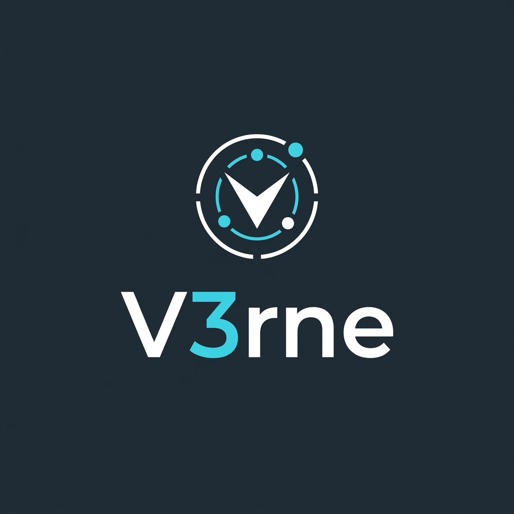

# V3rne



Lekki, lokalny system typu Mission Control do monitorowania projektów programistycznych rozwijanych ze wsparciem agentów AI.

Repozytoria są tylko do odczytu. Zadania, komentarze, wątpliwości i załączniki żyją w SQLite wewnątrz portalu, a agenci komunikują się przez MCP (`/mcp`).

## Szybki start z danymi demo

```bash
bun install
bun run seed            # demo-workspace/ + data/board.db + .env (jeśli nie istnieje)
bun run build:web
bun run dev
```

Otwórz `http://127.0.0.1:4321`. Seed jest idempotentny: jeśli baza ma już projekty, nic nie zmienia. Przy istniejącym `.env` wskazującym inny katalog seed ostrzeże, bo portal użyje wartości z `.env`. Aby zacząć od zera, usuń `data/` i `demo-workspace/` i uruchom seed ponownie.

## Własne projekty zamiast demo

Workspace ma jedno źródło: `WORKSPACE_PATH` w `.env` (ten sam plik czyta Bun i docker compose).

```bash
cp .env.example .env
# .env
WORKSPACE_PATH=/Users/twoj-user/Projects
```

1. Ustaw powyższą wartość w `.env`.

2. Uruchom `bun run dev` i wejdź w **Statystyki → Konfigurator projektów**.
3. Kliknij **Skanuj workspace** — skaner pokaże katalogi z `.git` do `scan_depth` poziomów.
4. Przy repozytorium kliknij **Dodaj do monitoringu**. Projekt dostaje `id` ze sluga nazwy, prefiks kodu z inicjałów i domyślne ścieżki planu oraz dokumentów agenta.
5. Powtórz skan, żeby zobaczyć nowe repozytoria. Poller Gita odświeża dane co `git_poll_interval_sec` (domyślnie 5 minut); przycisk „Odśwież Git” lub przy projekcie robi to od ręki.

Aby zacząć od zera z własnymi projektami, usuń `data/board.db` (demo dane) i uruchom serwer ponownie — `.env` zostaje bez zmian.

Projekty są monitorowane tylko do odczytu. Jeśli katalog zniknie albo zmieni nazwę, popraw `relPath` projektu (`PATCH /api/v1/projects/:id`).

## Uruchomienie lokalne (Bun)

Wymagania: Bun >= 1.0, `git` w PATH. Node nie jest wymagany.

```bash
bun install
bun run build:web     # buduje packages/web/dist
bun run dev           # serwer + UI pod http://127.0.0.1:4321
```

Tryb developerski UI z hot reloadem (osobny terminal):

```bash
bun run dev           # API na :4321
bun run dev:web       # Vite na :5173, proxy /api i /mcp na :4321
```

## Odczyt repozytoriów i ich awarie

- Każde polecenie Gita działa z `--no-optional-locks`. Krótkie błędy (timeout, kod ≠ 0) są ponawiane do 2 razy; „not a git repository” i uszkodzone `.git` nie są ponawiane.
- Gdy odczyt się nie uda, poller zostawia ostatni dobry snapshot z `stale: true` i `lastErrorAt`. Karta projektu pokazuje wtedy odznakę „dane z ostatniego udanego odczytu”.
- Detached HEAD i repo bez remote są obsługiwane normalnie (gałąź „detached”, bez strzałek ↑↓).
- Lista ostatnio ruszanych plików jest ucinana do 200; gdy jest ucięta, nagłówek projektu to oznacza.

Pomiar na syntetycznym monorepo (20 000 plików, 500 commitów, 3 worktrees, 50 gałęzi):

```bash
bun packages/server/scripts/bench-git.ts           # --keep zachowuje repo, --projects=N zmienia liczbę klonów
```

Typowe wyniki: pojedynczy snapshot ok. 50 ms; 10 projektów ok. 0,5 s, gdy indeks Gita jest ciepły, i ok. 4 s, gdy każdy projekt jest świeżym klonem.

Konfiguracja portalu: `data/config.yaml` (opcjonalny). Workspace ustawiaj wyłącznie w `.env`; `workspace_root` w tym pliku jest tylko zgodnościowym fallbackiem. Obsługiwane klucze:

```yaml
port: 4321
host: 127.0.0.1
git_poll_interval_sec: 300
max_attachment_bytes: 10485760    # limit pojedynczego pliku w REST
mcp_attachment_max_bytes: 5242880 # limit załącznika zwracanego przez MCP
defaults:
  scan_depth: 2
  plan_files: ["plan.md", "PLAN.md", "docs/plan.md", "docs/PRD.md"]
  plan_dirs: ["context", "docs"]
  plan_dir_exclude: ["archive", "node_modules", ".git"]
  agent_docs: ["AGENTS.md", "CLAUDE.md", "README_AI.md", ".cursorrules"]
```

Konfiguracja monitorowanych projektów jest w SQLite i edytowana przez UI (Konfigurator). `config.yaml` opisuje wyłącznie ustawienia portalu.

## Gdzie szukamy planów

Plan projektu to suma dwóch źródeł:

1. jawne ścieżki z `planFiles` (projektu lub `defaults.plan_files`) — czytane zawsze, nawet jeśli plik nie istnieje;
2. wszystkie pliki `*.md` znalezione rekurencyjnie (do 3 poziomów) w katalogach `planDirs` (`defaults.plan_dirs`, domyślnie `context` i `docs`).

Katalogi o nazwach z `plan_dir_exclude` (domyślnie `archive`, `node_modules`, `.git`) są pomijane na każdym poziomie, więc `context/archive/stary-plan.md` nie trafi do planu. Plik spoza tych katalogów (np. `README.md` w rootcie) również nie jest planem. Symlinki katalogów nie są śledzone, a skan zatrzymuje się na 200 plikach — wtedy odpowiedź planu ma `truncated: true`.

Katalogi można nadpisać per projekt: `planDirs` w `POST /api/v1/projects` / `PATCH /api/v1/projects/:id` (`null` przywraca wartość z `config.yaml`). Każdy plik w odpowiedzi planu ma `origin`: `file` (z `planFiles`) albo `dir` (znaleziony w katalogu).

## Podłączenie agenta

Endpoint MCP (Streamable HTTP): `http://127.0.0.1:4321/mcp`. Przykład dla OpenCode:

```json
{
  "mcp": {
    "agent-board": {
      "type": "remote",
      "url": "http://127.0.0.1:4321/mcp",
      "enabled": true
    }
  }
}
```

Dostępne narzędzia: `list_projects`, `get_project_context`, `list_tasks`, `get_next_task`, `get_task`, `list_doubts`, `create_tasks`, `update_task`, `add_entry`, `get_attachment`. Pełny kontrakt narzędzi i endpointów REST: [README_AI.md](/Users/tomaszwawrzyniak/Projects/v3rne/agent-board/README_AI.md).

Przykład — agent sprawdza wątpliwości i pobiera zadanie z historią:

```text
list_doubts()                       # otwarte wątpliwości ze wszystkich aktywnych projektów
get_task(task_code="WFC-14")        # zadanie z komentarzami, załącznikami i historią
```

## Testy

```bash
bun test                  # serwer + wspólne typy
bun test:web              # frontend
```

## Uruchomienie w Dockerze

```bash
cp .env.example .env
# ustaw WORKSPACE_PATH w .env
docker compose up --build
```

Portal dostępny pod `http://127.0.0.1:4321`. Katalog `data/` (SQLite, config.yaml, uploads) jest montowany z hosta. Repozytoria montowane są read-only pod identyczną ścieżką.

## Struktura

```
packages/shared   # typy TS i schematy Zod
packages/server   # Hono: REST /api/v1, MCP /mcp, SQLite, poller Git, parser plan.md
packages/web      # React + Vite + Tailwind: Radar, projekt, inbox, statystyki
```
